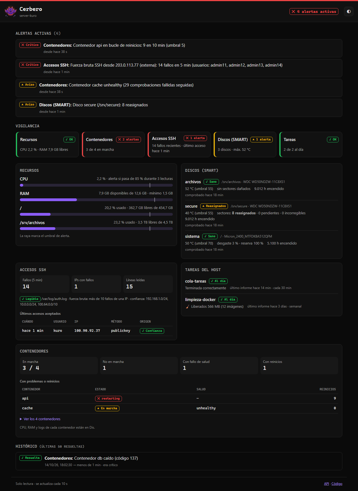

<p align="center">
  
</p>

<h1 align="center">Cerbero</h1>

Monitor de seguridad y estado de **server-kuro**. Vigila a la vez los recursos del host, los
contenedores Docker, los accesos SSH, la salud de los discos y las tareas programadas del
servidor, y avisa por Telegram cuando algo va mal. No sustituye
a Netdata en métricas detalladas: es la capa propia que solo avisa de lo que importa, sobre
todo en seguridad. Tiene su propia web de detalle y una API REST que consume
[Dis](https://github.com/kur0h3i/Dis).

> Cerbero es el perro de tres cabezas que guarda el tercer círculo del Infierno; aquí guarda
> el servidor ([por qué el nombre](#el-nombre-y-el-logo)).

- **Recursos**: CPU sostenida, RAM baja (el punto más ajustado del servidor), discos llenos o
  sin montar.
- **Contenedores**: caídas (distinguiendo una parada a mano de un fallo), bucles de reinicio y
  healthchecks `unhealthy`.
- **Accesos**: fuerza bruta por SSH, logins aceptados desde fuera de la LAN/WireGuard/Tailscale
  e intentos con usuarios válidos desde fuera. Sin fail2ban.
- **Discos (SMART)**: discos que fallan, sectores dañados, temperatura y desgaste del NVMe,
  leídos en el host por un timer de root para que Cerbero siga sin privilegios.
- **Tareas del host**: avisa si una tarea programada falla o deja de ejecutarse, y resume lo que
  hizo la limpieza semanal de imágenes Docker («🧹 Liberados 566 MB»).
- **Avisos que no hacen spam**: cooldown por alerta, recordatorio si el problema persiste y
  🟢 [RESUELTO] cuando se normaliza.
- **Web propia** en `http://IP-DEL-SERVIDOR:9666`: el estado de cada vigilancia, las alertas
  activas y el histórico, con modo claro y oscuro, también en el móvil.
- **Ligero y de solo lectura**: un contenedor de ~50 MiB de RAM sin privilegios que nunca
  modifica Docker ni el host.



## Índice

- [Puesta en marcha](#puesta-en-marcha)
- [Conectarlo con Dis](#conectarlo-con-dis)
- [La web](#la-web)
- [Qué vigila](#qué-vigila)
- [Alertas](#alertas)
- [Configuración](#configuración)
- [Seguridad](#seguridad)
- [Solución de problemas](#solución-de-problemas)
- [API](#api)
- [Desarrollo](#desarrollo)
- [El nombre y el logo](#el-nombre-y-el-logo)

## Puesta en marcha

**Requisitos:** Linux con Docker Engine y Docker Compose v2, y **rsyslog** para que exista
`/var/log/auth.log` (Debian 13 no lo instala por defecto):

```bash
ls -l /var/log/auth.log || sudo apt install rsyslog
```

1. **Crea el bot de Telegram.** Habla con [@BotFather](https://t.me/BotFather), `/newbot`, y
   guarda el token. Escríbele cualquier cosa a tu bot y saca tu `chat_id` de
   `https://api.telegram.org/bot<TOKEN>/getUpdates` (campo `message.chat.id`).
2. **Configura y arranca:**

   ```bash
   git clone https://github.com/kur0h3i/Cerbero.git
   cd Cerbero
   cp .env.example .env        # rellena TELEGRAM_TOKEN y TELEGRAM_CHAT_ID
   docker compose up -d --build
   ```

3. **Comprueba** que está en guardia. En unos segundos el contenedor aparece como `healthy` y
   llega a Telegram el aviso 🟢 *Cerbero en guardia*:

   ```bash
   docker compose ps                        # STATUS: Up … (healthy)
   curl http://192.168.1.60:9666/api/health # {"status":"ok","heads":{…: true}}
   docker stats --no-stream cerbero         # MEM USAGE ~50 MiB / 80 MiB
   ```

Para probar la cabeza de accesos sin esperar a un ataque, desde otro equipo de la LAN intenta
entrar 11 veces con un usuario que no existe:

```bash
for i in $(seq 11); do ssh -o BatchMode=yes -o ConnectTimeout=3 noexiste@192.168.1.60 true; done
```

Llega un 🟡 *Fuerza bruta SSH* (amarillo porque la IP es de confianza; desde fuera sería 🔴), y
un 🟢 [RESUELTO] a los 5 minutos.

### En el host: el volcado SMART

Leer SMART necesita root y Cerbero no lo tiene, así que lo hace un timer de systemd en el host
y Cerbero solo lee el resultado. Desde la carpeta del repo:

```bash
sudo host/smart/instalar.sh
```

Instala `smartmontools`, genera `/etc/cerbero/discos.conf` con los discos que encuentra (revísalo:
nombres, montajes y `opcional` para los que se montan a mano) y activa `cerbero-smart.timer`,
que cada hora deja un JSON por disco en `/var/lib/cerbero/smart/`. Detalles en la
[cabeza 4](#cabeza-4--discos-smart).

### En el host: las tareas

Las tareas son timers de systemd **de usuario** (sin root; hace falta estar en el grupo
`docker` y tener *linger*: `loginctl show-user $USER -P Linger` → `yes`). Una sola vez, con
sudo, la carpeta donde dejan sus informes:

```bash
sudo install -d -m 755 -o "$USER" -g "$USER" /var/lib/cerbero/tareas
```

Y después, con tu usuario y sin sudo:

```bash
host/tareas/instalar.sh --cola-json /ruta/al/estado.json   # el JSON que reescribe cola-tareas
systemctl --user start cerbero-limpieza.service            # opcional: limpiar ya
cat /var/lib/cerbero/tareas/limpieza-docker.json
```

Detalles en [tareas del host](#tareas-del-host).

## Conectarlo con Dis

Dis ya consulta `GET {CERBERO_URL}/api/alerts`. En el `.env` de Dis:

```bash
CERBERO_URL=http://192.168.1.60:9666
```

Si Cerbero está caído, Dis no puede conectar y muestra «Cerbero no conectado»; no hace falta
nada más.

En la tarjeta del contenedor, Dis muestra el logo de Cerbero: lo encuentra en
`/favicon.svg`. Su botón «Abrir» lleva a la [web de Cerbero](#la-web).

## La web

`http://IP-DEL-SERVIDOR:9666` (el botón «Abrir» de Dis lleva aquí). Es el **detalle de
Cerbero**; Dis sigue siendo el panel general del servidor, así que no repite lo que ya está allí
(CPU, RAM y logs de cada contenedor, el mapa de servicios):

- **Vigilancia**: una tarjeta por frente (recursos, contenedores, accesos SSH, discos, tareas)
  con su estado y un resumen.
- **Alertas activas**, de la más grave a la menos, y el **histórico** de las últimas 50
  resueltas con su duración.
- **Recursos**: CPU, RAM y discos con la marca del umbral en cada barra.
- **Discos (SMART)**, **accesos SSH** (fallos recientes y últimos logins aceptados, de confianza
  o externos), **tareas** y **contenedores** (los que tienen problemas primero).

Se actualiza cada 10 s y deja de consultar con la pestaña oculta. Sigue el tema del sistema
(claro u oscuro) y el botón ◐ lo cambia y lo recuerda. Cada estado lleva forma, texto y color
(✓ OK, ▲ Aviso, ✕ Crítico), no solo color.

Es HTML, CSS y JS sin dependencias ni compilación (`app/static/`), servido por el mismo
FastAPI: no añade contenedores y apenas memoria. De solo lectura, como la API.

## Qué vigila

### Cabeza 1 — Recursos

CPU, RAM y discos del host con `psutil`, cada `POLL_INTERVAL_S` segundos (30).

| Alerta | Nivel | Cuándo salta | Cuándo se resuelve |
|--------|-------|--------------|--------------------|
| CPU sostenida | 🟡 | La media del intervalo supera `CPU_THRESHOLD` en `CPU_SUSTAINED` lecturas seguidas (un pico suelto no cuenta) | Baja 5 puntos por debajo del umbral |
| RAM baja | 🔴 | La RAM disponible cae por debajo de `RAM_FREE_MIN_GB` | Sube 0.25 GB por encima del umbral |
| Disco lleno | 🟡 / 🔴 ≥ 95 % | Un punto de montaje de `DISKS` supera `DISK_THRESHOLD` | Baja 2 puntos por debajo del umbral |
| Disco ausente | 🟡 | Un punto de montaje no existe o no tiene su disco montado | Vuelve a estar montado |

- **RAM disponible, no "libre".** Se usa la memoria *disponible* (`MemAvailable`, lo que
  `free -h` llama *available*), que incluye la caché que el kernel libera cuando hace falta. La
  "libre" a secas no la cuenta y daría falsos críticos.
- **Discos sin montar.** Si un disco no se monta, su punto de montaje es un directorio vacío
  del disco raíz: medirlo daría el uso del raíz y lo que se escribiera ahí lo iría llenando. Por
  eso Cerbero comprueba que cada punto de montaje (salvo `/`) lo sea de verdad.
- **Márgenes de resolución.** Para dar una alerta por resuelta se exige un margen bajo el
  umbral, y así no salta y se resuelve con cada lectura.

### Cabeza 2 — Contenedores

Estado de los contenedores con el SDK oficial de Docker, cada `POLL_INTERVAL_S` segundos. Solo
lee: nunca arranca, para ni reinicia nada.

| Alerta | Nivel | Cuándo salta | Cuándo se resuelve |
|--------|-------|--------------|--------------------|
| Caída | 🔴 | Un contenedor que Cerbero vio en marcha pasa a `exited`/`dead` con un código de error, o lo mata el kernel por falta de memoria (OOM) | Vuelve a estar en marcha |
| Parada | 🟡 | Igual, pero por un `docker stop`/`compose stop`/`down` o con salida limpia (código 0 o 143) | Vuelve a estar en marcha |
| Bucle de reinicios | 🔴 | Más de `RESTART_LOOP_THRESHOLD` reinicios en `RESTART_LOOP_WINDOW_MIN` minutos | Una ventana entera sin reinicios |
| Unhealthy | 🟡 | Su healthcheck lo marca `unhealthy` (con la salida de la última comprobación) | Vuelve a `healthy` |
| Docker no responde | 🔴 | El socket de Docker falla dos lecturas seguidas | Docker responde de nuevo |

- **Los parados de antes no cuentan.** Los contenedores que ya estaban parados cuando arrancó
  Cerbero no generan alerta; solo los que caen mientras Cerbero está corriendo.
- **Parada manual vs. caída.** El código de salida no basta para distinguirlas: un proceso
  que ignora SIGTERM sale con 137 también en un `docker stop`. Por eso Cerbero consulta los
  eventos `stop` de Docker entre lectura y lectura: si hubo uno, es una parada a mano (🟡); un
  `docker kill` o un fallo del proceso es una caída (🔴).
- **Recordatorios.** Mientras un contenedor siga caído, la alerta crítica se recuerda tras el
  cooldown; una parada a mano se avisa una sola vez.
- Si se borra un contenedor, sus alertas se cierran. `CONTAINERS_IGNORE` excluye contenedores
  por nombre (p. ej. tareas puntuales que terminan solas).

### Cabeza 3 — Accesos

Sigue `/var/log/auth.log` como `tail -f` (lee solo lo nuevo, nunca el fichero entero) en un
hilo aparte, y analiza las líneas de sshd con expresiones regulares. No depende de fail2ban.

| Alerta | Nivel | Cuándo salta | Cuándo se resuelve |
|--------|-------|--------------|--------------------|
| Fuerza bruta | 🔴 IP externa / 🟡 IP de confianza | Más de `BRUTE_FORCE_THRESHOLD` fallos de login desde una IP en `BRUTE_FORCE_WINDOW_MIN` minutos | Una ventana entera sin fallos desde esa IP |
| Login externo | 🔴 | Un login SSH aceptado desde fuera de los rangos de confianza | Se cierra solo pasado el cooldown (es un evento, no una condición) |
| Intentos externos | 🟡 | Intentos fallidos con un usuario válido (que existe) desde fuera de los rangos de confianza | Una ventana entera sin intentos |
| Log ilegible | 🟡 | `auth.log` no existe o no se puede leer: la cabeza está ciega | Vuelve a poder leerse |

Rangos de confianza (`TRUSTED_NETWORKS`, definidos en `app/config.py`): LAN
`192.168.1.0/24`, WireGuard `10.0.0.0/24` y Tailscale `100.64.0.0/10`. El loopback siempre
es de confianza.

- **Qué es un fallo.** Cada línea `Failed <método>` y, si una conexión no tuvo ninguna, su
  cierre antes de autenticarse (`Connection closed by authenticating user ...`), que es lo
  único que deja un intento fallido con clave pública. No se cuenta el sondeo `Failed none` que
  hacen los clientes al empezar.
- **Botnets.** Los intentos externos con usuario válido van en una sola alerta agregada (con
  cuántos intentos y desde cuántas IPs), no en una por IP.
- **Memoria acotada durante un ataque.** Se siguen como mucho 2000 IPs a la vez (se descarta la
  que lleva más tiempo sin fallar, nunca el atacante activo) y 200 marcas de tiempo por IP (a
  partir de ahí el mensaje dice «200+ fallos»). Con una ráfaga de 63 000 líneas desde 6000 IPs,
  el contenedor pasa de ~49 a ~52 MiB.
- **Un usuario no puede falsear la IP.** El nombre de usuario lo elige quien se conecta y puede
  contener, p. ej., `from 192.168.1.5 port 1`. El parser se queda con la última IP de la línea,
  que es la que escribe sshd. Las líneas de otros programas que imitan a sshd se ignoran.
- **Rotación.** Se detecta tanto la rotación con fichero nuevo (lo normal en logrotate) como
  `copytruncate`. Al arrancar se empieza por el final: el histórico no genera alertas.
- **Formato de Debian 13.** OpenSSH 10 registra como `sshd-session` en vez de `sshd`, y
  rsyslog usa fechas RFC 3339; se aceptan ambos formatos. Para comprobar qué escribe tu
  servidor: `grep -E 'sshd(-session)?\[' /var/log/auth.log | tail`.
- **Hace falta rsyslog.** Debian 13 no lo instala por defecto (todo va a journald) y entonces
  `/var/log/auth.log` no existe. Cerbero lo avisa con la alerta *Log ilegible*; se arregla con
  `sudo apt install rsyslog`.

### Cabeza 4 — Discos (SMART)

SMART lo lee en el host `cerbero-smart.timer` (`host/smart/`), cada hora, y deja un JSON por
disco en `/var/lib/cerbero/smart/`. Cerbero lo lee cada 2 minutos a través de `/hostfs`.

| Alerta | Nivel | Cuándo salta | Cuándo se resuelve |
|--------|-------|--------------|--------------------|
| SMART fallido | 🔴 | El disco dice `FAILED` o, en NVMe, da un aviso crítico (reserva agotada, solo lectura...) | Vuelve a pasar |
| Sectores dañados | 🔴 | Sectores pendientes (197) o incorregibles (198), errores de medio en NVMe, o reasignados (5) que suben (se mantiene 24 h desde la última subida) | Vuelven a 0 |
| Sectores reasignados | 🟡 | Reasignados > 0 pero estables | Vuelven a 0 |
| Temperatura | 🟡 | Por encima de `SMART_TEMP_HDD_MAX` (discos) o `SMART_TEMP_NVME_MAX` (NVMe) | Baja 3 °C por debajo, o el disco entra en reposo |
| Desgaste | 🟡 | El NVMe ha gastado el 90 % de su vida útil | — |
| SMART ilegible | 🟡 | `smartctl` no puede leer el disco (p. ej. un puente USB sin soporte) | Vuelve a leerse |
| Disco desconectado | 🟡 | Un disco de `discos.conf` no está (salvo los marcados `opcional`) | Vuelve a estar |
| Datos sin actualizar | 🟡 | Algún disco lleva más de `SMART_MAX_AGE_H` horas sin comprobarse: el timer se ha parado | Vuelven a llegar datos |

- **Discos por `/dev/disk/by-id/`.** Con discos USB, `sda`/`sdb`/`sdc` cambian de letra al
  reiniciar o reconectar; el identificador por modelo y número de serie no.
- **No despierta discos dormidos.** El volcado usa `smartctl -n standby`: si un disco USB está
  en reposo no lo lee y conserva los datos de la última lectura completa. Si esta tiene más de
  24 h, lo lee aunque lo despierte.
- **Puentes USB.** Si el modo automático no entiende el puente, prueba `-d sat` y lo recuerda.
- **Discos cifrados.** SMART se lee del disco físico aunque el volumen LUKS esté cerrado; un
  disco `opcional` solo deja de vigilarse si está desconectado.
- **Reasignados estables, 🟡.** Un disco con unos pocos sectores reasignados desde hace años no
  merece un 🔴 cada media hora; que suban, sí.

`discos.conf`, un disco por línea (`opcional` y `tipo=sat` son optativos):

```
# nombre  dispositivo                                                   montaje        opciones
sistema   /dev/disk/by-id/nvme-Micron_2400_MTFDKBA512QFM_0000AAAA1111     /
extra     /dev/disk/by-id/usb-Seagate_Expansion_HDD_00000000AAAA1111-0:0  /srv/extra
archivos  /dev/disk/by-id/ata-WDC_WD50NDZW-11C8XS1_WD-WX00AAAA1111        /srv/archivos
secure    /dev/disk/by-id/ata-WDC_WD50NDZW-11C8XS1_WD-WX00BBBB2222        /srv/secure    opcional
```

Para ver qué haría con tus discos sin instalar nada: `sudo python3
host/smart/cerbero_smart.py --detectar`.

### Tareas del host

Cada tarea programada deja su último resultado en `/var/lib/cerbero/tareas/<tarea>.json` y
Cerbero lo lee cada minuto. Vale para cualquier tarea: basta con que escriba un informe así
(`host/tareas/informe_tarea.py` lo hace por ti):

```json
{"version": 1, "tarea": "limpieza-docker", "resultado": "ok", "fin": "2026-10-18T04:31:07+02:00",
 "cada_s": 604800, "resumen": "🧹 Liberados 566 MB (12 imágenes)", "avisar": true, "detalle": {}}
```

Si `fin` no lleva zona horaria, se interpreta en la `TZ` de Cerbero.

| Aviso | Nivel | Cuándo | Cuándo se resuelve |
|-------|-------|--------|--------------------|
| La tarea ha fallado | 🟡 | `resultado: "fallo"` | Con el siguiente informe correcto |
| La tarea no se ejecuta | 🟡 | El último informe es más viejo que `cada_s` × `TAREAS_TOLERANCIA` (el timer se ha parado) | Llega un informe nuevo |
| Resumen | 🟢 | Un informe nuevo, correcto y con `avisar: true`: se manda su `resumen` una vez | — (queda en el historial) |

Para engancharlo a una unidad de systemd que ya existe, sin tocar su código, basta con un
`ExecStopPost=`: systemd lo ejecuta también cuando el servicio falla y le dice cómo terminó.

```ini
ExecStopPost=/usr/bin/python3 %h/.local/lib/cerbero/informe_tarea.py systemd --tarea mi-tarea --cada 3600
```

**Cola de tareas del vault** (`cola-tareas.timer`, de usuario, cada 30 min). El instalador le
añade un *drop-in* (`~/.config/systemd/user/cola-tareas.service.d/cerbero.conf`) con el
`ExecStopPost=` de arriba; la unidad y su script no se tocan. Avisa si el servicio falla y, a la
hora sin informe, de que el timer no corre. Con `--cola-json RUTA` comprueba además que cada
ejecución reescribe su JSON de estado (el que lee Dis): si el servicio «termina bien» pero el
fichero tiene más de 30 min, también es un fallo. Esa comprobación la hace el `ExecStopPost`,
que corre como tu usuario: Cerbero no puede entrar en tu home.

**Limpieza semanal de imágenes Docker** (`cerbero-limpieza.timer`, de usuario). Los domingos a
las 04:30 (o al arrancar, si el servidor estaba apagado) ejecuta
`docker image prune -a -f --filter until=168h`: borra las imágenes que no usa ningún contenedor
y tienen más de 7 días. Manda «🧹 Liberados X MB (N imágenes)» si ha borrado algo; si falla, 🟡
con el motivo. Quien borra es el timer, con tus permisos: Cerbero sigue sin escribir en Docker.

## Alertas

Cada cabeza dispara alertas con uno de tres niveles: `info` 🟢, `warning` 🟡 y `critical` 🔴.
Llegan a Telegram con este formato:

```
🔴 [CRÍTICO] Cabeza: Recursos
Mensaje: RAM libre 0.8 GB (umbral 1.5 GB)
Servidor: server-kuro · 2026-09-30 03:14:22
```

```
🟢 [RESUELTO] Cabeza: Recursos
Mensaje: RAM libre recuperada (1.9 GB)
Servidor: server-kuro · 2026-09-30 03:44:05
```

- **Una alerta por condición.** Cada alerta tiene una clave (`recursos:ram`,
  `contenedores:caido:nginx`...). Mientras la condición dura, la alerta sigue activa y no se
  duplica.
- **Cooldown.** Una alerta con la misma clave no se reenvía hasta pasados
  `ALERT_COOLDOWN_MIN` minutos, aunque entre medias se resuelva y vuelva a saltar. Si el
  problema persiste, pasado ese tiempo llega un recordatorio con la hora de inicio.
- **Si empeora, avisa ya.** Si una alerta sube de nivel (de 🟡 a 🔴), se envía sin esperar al
  cooldown.
- **Resolución.** Cuando la condición se normaliza llega un 🟢 [RESUELTO], solo si la alerta
  original se había notificado.
- **Sin inundar el chat.** Como mucho se envían 20 mensajes por minuto; lo que no se envía queda
  igualmente en la API.
- **En memoria.** Las alertas activas se conservan todas y, de las resueltas, las últimas 50.
  Si Cerbero se reinicia, el historial se pierde.

## Configuración

### Variables de entorno (`.env`)

Todas son opcionales salvo las de Telegram (sin ellas las alertas solo quedan en el registro y
en la API). Una variable vacía equivale a no definirla. `.env.example` las documenta todas.

| Variable | Por defecto | Qué hace |
|----------|-------------|----------|
| `CERBERO_PORT` | `9666` | Puerto del host en el que se publica la API |
| `TELEGRAM_TOKEN` | — | Token del bot (de @BotFather) |
| `TELEGRAM_CHAT_ID` | — | Chat al que se envían las alertas |
| `SERVER_NAME` | `server-kuro` | Nombre del servidor en los mensajes |
| `TZ` | `Europe/Madrid` | Zona horaria de las fechas |
| `ALERT_COOLDOWN_MIN` | `30` | Minutos antes de reenviar una alerta con la misma clave |
| `NOTIFY_STARTUP` | `true` | Aviso 🟢 al arrancar (sirve para enterarse de un reinicio) |
| `POLL_INTERVAL_S` | `30` | Segundos entre lecturas de recursos y contenedores |
| `CPU_THRESHOLD` | `85` | % de CPU a partir del cual una lectura es alta |
| `CPU_SUSTAINED` | `3` | Lecturas altas seguidas para alertar |
| `RAM_FREE_MIN_GB` | `1.5` | GB de RAM disponible por debajo de los cuales se alerta |
| `DISK_THRESHOLD` | `85` | % de uso de disco a partir del cual se alerta |
| `DISKS` | `/,/srv/archivos,/srv/extra` | Puntos de montaje vigilados, separados por comas |
| `HOST_ROOT` | `/` | Dónde ve Cerbero la raíz del host (`/hostfs` en Docker, ya puesto en el compose) |
| `RESTART_LOOP_THRESHOLD` | `5` | Reinicios (más de) que cuentan como bucle |
| `RESTART_LOOP_WINDOW_MIN` | `10` | Ventana en minutos para contar reinicios |
| `CONTAINERS_IGNORE` | — | Contenedores que no generan alertas, separados por comas |
| `AUTH_LOG` | `/var/log/auth.log` | Log de autenticación del host |
| `BRUTE_FORCE_THRESHOLD` | `10` | Fallos (más de) desde una IP que cuentan como fuerza bruta |
| `BRUTE_FORCE_WINDOW_MIN` | `5` | Ventana en minutos para contar fallos |
| `TRUSTED_NETWORKS` | `192.168.1.0/24,10.0.0.0/24,100.64.0.0/10` | Rangos de confianza, separados por comas (sustituyen a los de `app/config.py`) |
| `SMART_DIR` | `/var/lib/cerbero/smart` | Dónde deja los JSON `cerbero-smart.timer` (ruta del host) |
| `SMART_MAX_AGE_H` | `3` | Horas sin comprobar un disco a partir de las cuales se avisa |
| `SMART_TEMP_HDD_MAX` | `55` | °C a partir de los cuales un disco duro está caliente (los de 2,5" en caja USB rondan los 50) |
| `SMART_TEMP_NVME_MAX` | `70` | °C a partir de los cuales el NVMe está caliente |
| `TAREAS_DIR` | `/var/lib/cerbero/tareas` | Dónde dejan sus informes las tareas (ruta del host) |
| `TAREAS_TOLERANCIA` | `2` | Una tarea «no se ejecuta» si su informe tiene más de su periodo por esto |
| `LOG_LEVEL` | `INFO` | Nivel del registro |

### Qué monta el compose

| Montaje | Para qué |
|---------|----------|
| `/var/run/docker.sock` (`:ro`) | Cabeza de contenedores: listar, inspeccionar y leer eventos |
| `/` → `/hostfs` (`:ro`) | Discos (`/srv/archivos` y `/srv/extra` entran por ser submontajes), `/var/log/auth.log` y los JSON de `/var/lib/cerbero/` (SMART y tareas) |

Se monta la raíz y no `auth.log` suelto a propósito: el bind mount de un fichero se queda
apuntando al viejo cuando logrotate lo rota, y Cerbero dejaría de ver accesos sin avisar.

No hacen falta `pid: host`, `network_mode: host` ni `SYS_PTRACE`: CPU y RAM del host se leen de
`/proc/stat` y `/proc/meminfo`, que no están aislados por namespace, y las IPs de SSH vienen en
`auth.log`, que escribe el sshd del host.

## Seguridad

- **Sin privilegios.** `cap_drop: ALL`, `no-new-privileges`, sistema de ficheros de solo
  lectura y `mem_limit: 80m`. Corre como root dentro del contenedor solo para poder leer
  `auth.log` (`root:adm 640`) y el socket de Docker (`root:docker 660`), que son de root.
- **El socket de Docker da control total** de Docker aunque se monte `:ro` (ese `:ro` solo
  afecta al fichero). Cerbero solo hace llamadas de lectura: listar, inspeccionar y eventos.
- **La web** solo carga recursos de Cerbero, sin nada en línea (CSP `default-src 'self'`), no
  se puede incrustar en otra página (`frame-ancestors 'none'`) y pinta los datos como texto: un
  nombre de usuario de SSH con HTML no se ejecuta.
- **La API no tiene autenticación** y es de solo lectura. Solo publica el puerto 9666 en la LAN
  (`192.168.1.60`) y en Tailscale (`100.87.200.60`), no en todas las interfaces: tampoco lo
  redirijas en el router. Si Tailscale no ha levantado su IP cuando Docker arranca el
  contenedor, este no arranca (`docker compose up -d` otra vez cuando ya esté). Otra IP o red:
  cambia las líneas de `ports` en `docker-compose.yml`.
- **Lo que necesita root se queda en el host.** `cerbero-smart.service` es el único que corre
  como root (`smartctl` habla directamente con los discos), con la unidad cerrada: sin red,
  sistema de ficheros de solo lectura salvo `/var/lib/cerbero/smart` y sin acceso a `/home`.
- **Las tareas no son de Cerbero.** La limpieza de imágenes la hace un timer de tu usuario con
  sus permisos de Docker; Cerbero solo lee su informe. Los informes van a `/var/lib/cerbero/`
  y no a tu home porque este es `700` y Cerbero, sin capacidades, no podría entrar.
- **El token de Telegram** va en `.env` (ignorado por git) y nunca aparece en los registros:
  httpx está silenciado porque escribiría la URL, que lo contiene.
- **Las entradas de `auth.log` no son de fiar.** El nombre de usuario lo controla quien se
  conecta; ver *Un usuario no puede falsear la IP* en la [cabeza de accesos](#cabeza-3--accesos).

## Solución de problemas

**`accesos: false` en `/api/health` y alerta «No se puede leer /var/log/auth.log».** Falta
rsyslog (`sudo apt install rsyslog`) o `AUTH_LOG` apunta a otro sitio. Cerbero lo detecta solo
en cuanto el fichero aparece.

**No llega nada a Telegram.** Mira `docker compose logs cerbero`: si pone «Telegram no
configurado», faltan `TELEGRAM_TOKEN` o `TELEGRAM_CHAT_ID`; si pone «Telegram rechazó el
mensaje (400)», el `chat_id` es incorrecto o no le has escrito antes al bot.

**Alerta «Disco /srv/extra: no está montado».** El disco no se ha montado en el host (revisa
`/etc/fstab` y `mount | grep srv`) o esa ruta no es un punto de montaje: quítala de `DISKS`.

**Un contenedor que termina solo (un cron, un backup) avisa al acabar.** Añádelo a
`CONTAINERS_IGNORE`.

**`smart: false` y alerta «Sin datos SMART».** Falta instalar el volcado del host
(`sudo host/smart/instalar.sh`). Si la alerta es «Datos SMART sin actualizar», el timer se ha
parado: `systemctl status cerbero-smart.timer` y `journalctl -u cerbero-smart.service -n 20`.

**«No se puede leer SMART de …: Unknown USB bridge».** Añade `tipo=sat` a ese disco en
`/etc/cerbero/discos.conf` (el volcado ya lo intenta solo) y lanza
`sudo systemctl start cerbero-smart.service`.

**«…: código 2: no se pudo abrir el disco o no respondió a IDENTIFY».** La caja USB no deja
pasar SMART en ningún modo (le pasa al Seagate Expansion `0bc2:2036`: «Read Device Identity
failed»). Quita ese disco de `discos.conf` (`sudo sed -i '/^extra /d' /etc/cerbero/discos.conf`):
algunos puentes se reinician si se les insiste y el disco se desmonta. `--detectar` ya los deja
comentados. El timer borra su JSON en la siguiente pasada (cada hora, o ya con
`sudo systemctl start cerbero-smart.service`) y entonces Cerbero cierra sus alertas.
Su espacio libre y que siga montado los vigila igualmente la cabeza de recursos.

**«La tarea … no se ejecuta».** El timer se ha parado o la sesión de usuario no arranca sin
login: `systemctl --user list-timers`, `systemctl --user status <tarea>.timer` y
`loginctl show-user $USER -P Linger` (debe decir `yes`; si no, `sudo loginctl enable-linger $USER`).

**`tareas: false` y alerta «No se pueden leer los informes de tareas».** Falta la carpeta:
`sudo install -d -m 755 -o "$USER" -g "$USER" /var/lib/cerbero/tareas`.

**`contenedores: false` y alerta «No se puede consultar Docker».** Comprueba que el socket está
montado y que Docker funciona (`docker ps` en el host).

## API

Sin autenticación (Cerbero solo es accesible dentro de la LAN y la tailnet) y de solo lectura.
Documentación interactiva en `/api/docs`.

| Método | Ruta | Respuesta |
|--------|------|-----------|
| GET | `/api/health` | `{status, heads: {recursos, contenedores, accesos, smart, tareas}}` |
| GET | `/api/alerts` | `{connected: true, alerts: [...]}`; `?active=true` deja solo las activas |
| GET | `/api/status` | `{servidor, umbrales, cpu_pct, ram_free_gb, ram_total_gb, disks, containers, smart, tareas, accesos}` |

`/api/health` responde `status: "ok"` si todas las cabezas funcionan y `"degraded"` si alguna no
(p. ej., la de accesos si no puede leer `auth.log`); cada cabeza, `true` o `false`.

`/api/alerts` es lo que consume Dis. Primero van las activas y luego las resueltas, de la más
reciente a la más antigua:

```json
{
  "connected": true,
  "alerts": [
    {
      "id": "3f9a1c2b7d10",
      "key": "recursos:ram",
      "level": "critical",
      "head": "recursos",
      "message": "RAM libre 0.8 GB (umbral 1.5 GB)",
      "timestamp": "2026-09-30T03:14:22+02:00",
      "active": true,
      "resolved_at": null
    }
  ]
}
```

`/api/status` es la última lectura de cada vigilancia, más los umbrales en uso (valores `null`
durante los primeros segundos tras arrancar). Abreviado:

```json
{
  "cpu_pct": 12.6,
  "ram_free_gb": 3.9,
  "ram_total_gb": 11.6,
  "disks": [
    {"mount": "/", "total_gb": 234.0, "used_gb": 120.5, "free_gb": 101.6, "percent": 54.3, "error": null}
  ],
  "containers": [{"name": "jellyfin", "status": "running", "health": "healthy", "restarts": 0}],
  "smart": [
    {"nombre": "archivos", "estado": "ok", "montaje": "/srv/archivos", "modelo": "WDC WD50NDZW-11C8XS1",
     "salud": true, "temp_c": 38, "horas": 9012, "reasignados": 0, "pendientes": 0, "incorregibles": 0,
     "comprobado": "2026-10-14T10:00:03+02:00", "leido": "2026-10-14T10:00:03+02:00", "...": "..."}
  ],
  "tareas": [
    {"tarea": "limpieza-docker", "resultado": "ok", "fin": "2026-10-18T04:31:07+02:00",
     "cada_s": 604800, "resumen": "🧹 Liberados 566 MB (12 imágenes)", "parada": false}
  ],
  "accesos": {
    "log": "/var/log/auth.log", "legible": true, "lineas": 1532, "ips_seguidas": 1, "fallos_ventana": 14,
    "ultimos_accesos": [{"fecha": "2026-10-14T09:05:50+02:00", "usuario": "kuro", "ip": "100.90.92.37",
                         "metodo": "password", "confianza": true}]
  },
  "servidor": "server-kuro",
  "umbrales": {"cpu_pct": 85, "ram_libre_min_gb": 1.5, "disco_pct": 85, "fuerza_bruta": 10, "...": "..."}
}
```

## Desarrollo

```bash
python3.12 -m venv .venv && source .venv/bin/activate
pip install -e ".[dev]"
ruff check . && ruff format --check .
pytest

# Arrancarlo en local, contra el Docker y los discos de tu máquina:
AUTH_LOG=/var/log/auth.log DISKS=/ uvicorn --factory app.main:create_app --port 9666
```

### Estructura

```
app/
├── main.py              arranque: API + las cabezas (asyncio y un hilo)
├── config.py            umbrales, Telegram y rangos de red de confianza
├── store.py             AlertStore: activas + últimas 50 resueltas, en memoria
├── alerter.py           Telegram, cooldown, recordatorios y resolución
├── api.py               /api/health, /api/alerts, /api/status
├── static/              la web: index.html, app.css, app.js (sin compilar)
└── heads/
    ├── recursos.py      cabeza 1: psutil
    ├── contenedores.py  cabeza 2: Docker SDK
    ├── accesos.py       cabeza 3: tail de auth.log
    ├── smart.py         cabeza 4: JSON de SMART que deja el host
    └── tareas.py        informes de las tareas programadas del host
host/
├── smart/               volcado SMART en el host (root): script, unidades e instalador
└── tareas/              tareas de usuario: informes, limpieza semanal e instalador
tests/                   pytest (sin Docker, red ni discos: todo con dobles)
assets/                  logo
docs/                    captura de la web
```

## El nombre y el logo

> *Cerbero, fiera crudele e diversa,*
> *con tre gole caninamente latra*
> *sovra la gente che quivi è sommersa.*
>
> — Dante, *Infierno*, VI, 13-15

Cerbero guarda el tercer círculo del *Infierno* de Dante, el de los golosos, y ladra con sus
tres gargantas a quien se acerca. Aquí las cabezas vigilan cinco frentes: recursos, contenedores,
accesos, discos y tareas. El logo, en la misma paleta que Dis y Caronte, dibuja el Canto VI:

- **Las tres cabezas** en el violeta de Dis, con el borde al rojo vivo.
- **«Li occhi ha vermigli»** (v. 16): los ojos de brasa.
- **El collar de púas**, del mismo fuego que las murallas de Dis.
- **La lluvia eterna** del tercer círculo, «grandine grossa, acqua tinta e neve» (v. 10), en
  el lila de la Estigia.

`assets/cerbero-logo.svg` es el logo sin fondo; `assets/cerbero.svg`, la variante con fondo
oscuro redondeado para usar como icono.

## Hoja de ruta

- **Eventos de Gerión.** Cuando exista el honeypot, recibir sus eventos (alguien ha tocado el
  señuelo) y tratarlos como alertas de accesos: 🔴 por defecto, porque nadie legítimo debería
  llegar ahí. Pendiente de definir cómo los entrega Gerión (un JSON en
  `/var/lib/cerbero/` como las tareas, o una llamada a Cerbero, que entonces dejaría de ser
  solo lectura y necesitaría autenticación).
- **Backup del vault Cerebro.** Hoy no hay ninguno. Cuando exista, basta con que su timer deje
  un informe de tarea (`ExecStopPost=… informe_tarea.py systemd --tarea backup-cerebro --cada
  86400`) para que Cerbero avise si falla o deja de ejecutarse, sin tocar Cerbero.
- **En Dis.** Mostrar solo las alertas activas (`/api/alerts?active=true`) con su color por
  nivel, y pintar sin el recuadro claro los logos que ya traen fondo (los de Cerbero, Caronte y
  el propio Dis).
